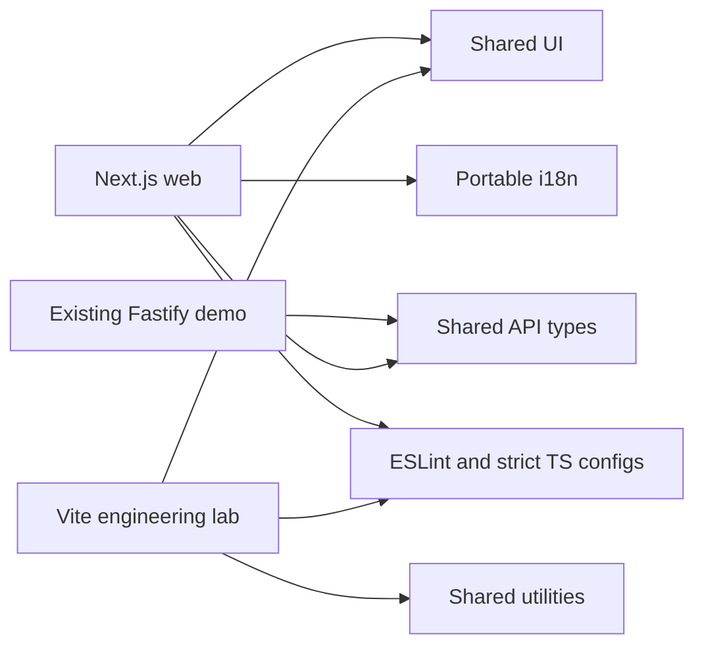
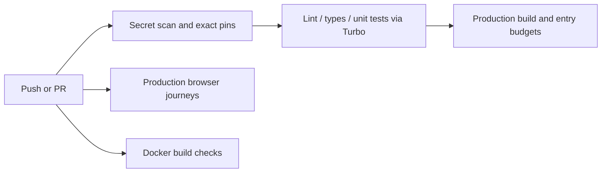

# Engineering baseline and continuation

The repository retains its existing Next/Fastify demonstration. The engineering-only consumer is apps/admin: a minimal Vite page using packages/ui and packages/utils without authentication, database or product features. Existing config-eslint/config-typescript names are preserved to avoid breaking previous template consumers; they serve the uploaded prompt's eslint-config/tsconfig roles.





## Local commands

Use Node 22.20.0 and the root-pinned pnpm 11.7.0. New tools use exact direct versions; existing direct dependency ranges were pinned to their previous lockfile resolutions rather than deliberately upgraded. Peer ranges describe compatibility and are not installation requests.

```sh
pnpm install --frozen-lockfile
pnpm --filter @repo/admin dev
pnpm --filter @repo/admin build
pnpm --filter @repo/admin e2e
node scripts/verify-pins.mjs
node --test scripts/tests/*.test.mjs
```

The Vite page uses loopback port 3300. Its Playwright suite serves the built dist, not a development server. The production build must exist first. pnpm test includes UI rendering/behavior contracts, utility validation and ESLint RuleTester cases. Node script tests also cover aggregate and entry-asset budget contracts.

Local hooks use Husky + lint-staged + commitlint. Staged package files run through their own ESLint configuration. Hooks are skipped for source archives/CI/production installation; CI remains the enforcement authority. Example commit: feat(tooling): add shared package gates.

## GitHub operator checklist

- Require pull requests, disallow force pushes and require quality-gate plus e2e (existing job names are preserved).
- Add the container check when container delivery is required. Require updated branches or a merge queue according to the repository's collaboration policy.
- Configure preview and production GitHub Environments independently. Add required production reviewers and restrict production branches. Never share deployment secrets with fork PR jobs.
- Keep pnpm/Turbo cache keys tied to the dependency lock and OS/runtime. Browser binaries are cached by OS and lock, but system libraries are still installed on a cache hit.
- Enable CodeQL/dependency review if desired; gitleaks is included in the quality job. No real secrets should be placed in YAML or reports.

No repository protection settings are silently changed by this continuation. Earlier successful runs do not prove this changed workflow passes; consult the continuation verification report.

## Outstanding external targets

Vercel CI-prebuilt deployment, GHCR publication, affected-package filtering, Sentry SDK/event verification, controlled heavy-dependency before/after measurement and single-/multistage image comparison remain separately tracked in engineering-continuation.md. They are not completed simply by this guide. The existing Virginia deploy is independent and remains unchanged.

See perf-report-template.md for corrected measurements, domain-environments.md for DNS/mail/environment templates and observability.md for monitoring setup boundaries.
